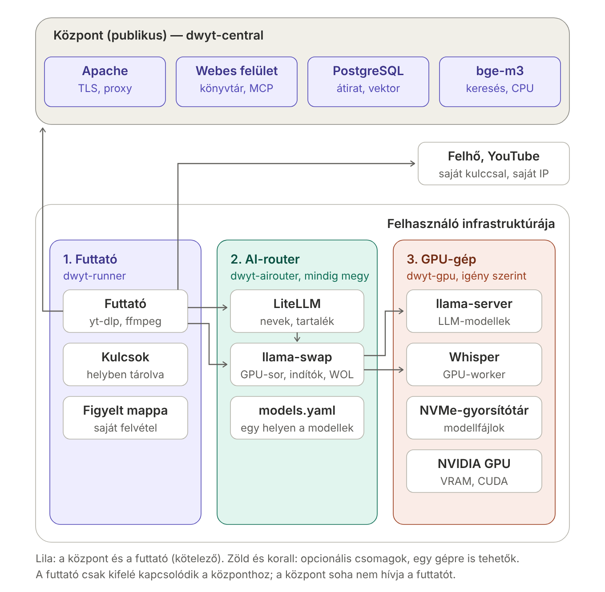

# dwyt – funkcionális terv

Állapot: 2026. október 10. Az 1. kör elkészült és élesben fut (`dwyt-central`, `dwyt-runner`); a 2. kör (saját GPU: `dwyt-airouter`, `dwyt-gpu`, helyi Whisper a futtatóban) is elkészült és élesben működik (Unraid-indítóval, 2026. október 11.). A 3. kör (fordítás, keresés, újrahasznosítás, saját felvételek, kvóták) elkészült; a 3a élesben fut, a 3b éles kipróbálásra vár. Ez a dokumentum rögzíti a megbeszélt döntéseket; minden későbbi lépés erre hivatkozik, és ha egy döntés változik, itt kell átírni (a fejezetben és a 21. fejezet döntésnaplójában is).

## 1. Cél

Videók és hangfelvételek átirata (időbélyeggel, beszélőkkel), magyar fordítása és magyar összefoglalója, felhasználónként külön, kereshető könyvtárban, a YouTube-feliratkozások háttérfeldolgozásával. Interneten elérhető szolgáltatás, amelyet bárki telepíthet, és amelyre meghívással (vagy a telepítő döntése szerint nyitottan) lehet regisztrálni.

Alapelvek:

- **A pénzbe kerülő, titkos és a médiához nyúló munka a felhasználónál fut**, a saját futtatóján (8. fejezet). A központ irányít és tárol, nem számol.
- **Mindenkinek külön könyvtára van**, a felhasználók nem látnak át egymáshoz. Ugyanazon a forráson végzett munka (átirat, fordítás, összefoglaló) a szabályok szerint újrahasznosítható (7. fejezet).
- **Felhős szolgáltatás csak a felhasználó saját kulcsával** (AssemblyAI, OpenRouter vagy más), a költség az övé.
- **Saját helyi AI** (GPU, helyi LLM) bekapcsolható, másik hálózatban is (9–10. fejezet).
- **Nincs csendes átváltás** az átírási módok között; ami láncolat (felirat → helyi → felhő), az kifejezett, beállított szabály.

## 2. Viszony a régi rendszerhez

A régi rendszer (`yt-transcribe` és `yt-transcribe-webui`) változatlanul megmarad és fut tovább; a dwyt külön repókban, külön életet él. Ha a dwyt már jól működik, akkor dől el, kell-e még a régi.

Amit a dwyt a régiből átvesz (kódban és tapasztalatban):

- a yt-transcribe API letöltés-, ffmpeg-, felirat- és felhős kódja → a futtatóba;
- a GPU-worker (WhisperX, wav2vec2, pyannote) → a GPU-gép csomagjába;
- a llama-swap + LiteLLM felállás és az Unraid-indító → az AI-router csomagjába;
- a webui könyvtára, keresése (PostgreSQL, `pgvector`, `bge-m3`), összefoglaló- és fordításlogikája, postaládája, MCP-je → a központba, többfelhasználóssá alakítva.

A régi könyvtár tartalma később egyszeri behozatallal kerülhet át a tulajdonos fiókjába (18. fejezet); a dwyt üresen indul.

## 3. Repók és telepítési egységek

| Repó | Mi | Hol fut | Licenc |
| --- | --- | --- | --- |
| `dwyt-docs` | Ez a terv, az architektúra, a döntésnapló és a központ–futtató protokoll | – | MIT |
| `dwyt-central` | Központ: webes felület, belépés, könyvtár, keresés, postaláda, munkasor, MCP | Egy publikus szerver (a tulajdonosnál: Proxmox LXC) | AGPL-3.0 |
| `dwyt-runner` | Futtató: letöltés, felirat, felhős átírás, LLM-hívások, figyelt mappa | A felhasználó gépe vagy VPS-e; Linux, Windows, macOS | MIT |
| `dwyt-airouter` | AI-router: LiteLLM + llama-swap, indítók, ébresztés, `models.yaml` | Mindig bekapcsolt gép a felhasználónál | MIT |
| `dwyt-gpu` | GPU-gép: llama-server, Whisper GPU-worker, modellek letöltése | NVIDIA GPU-s gép, igény szerint bekapcsolva | MIT |

Telepítéskor a felhasználónak a futtató kötelező, az AI-router és a GPU-gép opcionális. A három csomag egy gépre is tehető, de mindegyik külön telepítés.

A tulajdonos saját felállása: központ a Proxmoxon (publikus, Apache mögött), futtató és AI-router az `ai-router` LXC-ben, GPU-gép az Unraidon (Unraid-indítóval).

## 4. Architektúra

Forrás: [architektura.svg](architektura.svg).

Adatfolyamok:

1. A **futtató kapcsolódik ki** a központhoz HTTPS-en: munkát kér, eredményt ad le. A központ soha nem hívja a futtatót; a futtatónak nem kell nyitott port, VPN vagy NAT-beállítás.
2. A futtató a **felhőt** (felhős átírás, felhős LLM) a felhasználó saját kulcsával hívja, a **YouTube-ot** a saját IP-címéről éri el.
3. A futtató a **helyi AI-t** két címen éri el: az „LLM-cím” (LiteLLM vagy bármely OpenAI-kompatibilis szerver) és a „Whisper-cím” (a llama-swap felől a GPU-worker). Neki mindegy, mi van mögöttük.
4. Az **AI-router** llama-swapja egyedül birtokolja a GPU-t: indítja és leállítja a GPU-gép konténereit, és sorba állítja a kéréseket. A felhasználó többi kliense (OpenCode, Hermes, Open WebUI) is a LiteLLM-re mutat, így náluk sem okoz gondot, ha a GPU épp Whispert futtat.
5. A **keresés** a központban fut (a kérdést is vektorrá kell alakítani, és a futtató kikapcsolt állapotában is működnie kell).

## 5. Felhasználók, belépés, jogosultságok

- **Regisztrációs mód** telepítéskor: nyitott / meghívásos / zárt. A tulajdonos példánya meghívásos.
- **Meghívás:** az admin felvesz egy e-mail-címet; a rendszer egyszer használható, 7 napig érvényes meghívólinket készít, és e-mailben elküldi (ha a telepítő adott SMTP-szervert), különben az admin másolja ki és küldi el. Belépni csak az a Google-fiók tud, amelynek ellenőrzött e-mail-címe egyezik a meghívóval.
- **Belépés Google-lel** (OpenID Connect, „Web application” típusú OAuth-kliens, a nyilvános HTTPS-címre visszairányítva). A fiókot a Google állandó azonosítója (`sub`) köti, nem az e-mail-cím.
- **Második faktor:** a Google-fiók adja; telepítési beállítással kötelezővé tehető egy saját TOTP is a Google-belépés után.
- **Admin tartalékbelépés:** jelszó + TOTP, csak az admin fióknak, Google-kiesés vagy fióktiltás esetére.
- **Google-fiók nélküli felhasználó** az első körben nem lehet; a következő körben meghívólinkkel passkey-t regisztrálhat. További belépési szolgáltatók (Microsoft, GitHub) később.
- **Szerepek:**
  - *admin:* meghív, letilt, töröl; látja a fiókok adatait, a tárhely- és munkastatisztikát, a futtatók állapotát. **Nem látja** a felhasználók könyvtárát (átiratok, összefoglalók, keresések); a felületen erre nincs út, és ezt az adatvédelmi tájékoztató is így írja.
  - *felhasználó:* a saját könyvtára, futtatói, tokenjei, csatornái.
- **Fióktörlés** a felhasználó által: mindent töröl (könyvtár, tokenek, csatornák, futtatók). A másik felhasználónak már átadott (újrahasznosított) eredmény nála megmarad.
- **YouTube-feliratkozások:** ugyanaz a Web OAuth-kliens, de a `youtube.readonly` engedélyt csak akkor kéri, amikor a felhasználó bekapcsolja a feliratkozásokat. Ellenőrzés (Google verification) nélkül a felhasználók az „unverified app” figyelmeztetést látják, és legfeljebb 100 felhasználó engedélyezheti; a sima belépéshez (név, e-mail) nem kell ellenőrzés.

## 6. Könyvtár

- Felhasználónként külön: elemek, átiratok (elemenként több, egy fő), fordítások, összefoglaló-változatok, keresési darabok, címkék, jegyzetek, beszélőnevek. Minden felhasználói táblán ott a felhasználó, és a szétválasztást két védvonal őrzi:
  - *az alkalmazás:* minden lekérdezés a felhasználóra szűr;
  - *az adatbázis (sorvédelem, PostgreSQL row-level security):* a táblákon szabály áll (`USING`/`WITH CHECK user_id = current_setting('dwyt.user_id')`), és a központ minden kérés tranzakciójának elején `SET LOCAL dwyt.user_id`-t állít. Így egy kimaradt szűrő sem ad ki idegen sort, beállítás nélkül pedig a lekérdezés hibát ad. Az alkalmazás nem tulajdonos, a szabályt meg nem kerülő szerepkörrel kapcsolódik; a migrációk a tulajdonos szerepkörrel futnak. A szándékosan felhasználók közötti munkák (újrahasznosítás keresése, RSS-figyelés, admin statisztika) külön, szűk kódrészben, külön szerepkörrel futnak. Egy teszt szándékosan szűrő nélkül kérdez, és ellenőrzi, hogy idegen sor nem jön vissza.
- **Saját felvétel** (feltöltés, figyelt mappa) és **nyilvános forrás** (YouTube, URL) megkülönböztetése megmarad: saját felvétel csak a felhasználó helyi LLM-jéhez mehet automatikusan, felhős LLM-hez csak a felhasználó kifejezett beállításával.
- Hang és videó a központban nem tárolódik (a központon átmenő feltöltés csak addig, amíg a futtató át nem vette; 8. fejezet).
- Személyes kiegészítések (5. kör): címkék (a Könyvtárban szűrhető), jegyzet (a Könyvtár szűrője keres benne), a beszélők elnevezése átiratonként (csak a felhasználónál látszik: az átiraton, az összefoglalóban, a letöltésekben, az exportban és az MCP-n át; a közös eredmény nem változik), a teljes könyvtár exportja ZIP-ben (Markdown elemenként vagy egy JSON).

## 7. Újrahasznosítás

Ha egy felhasználó olyan munkát kér, amit valaki már elvégzett ugyanazon a forráson ugyanazokkal a beállításokkal, a központ nem küldi ki a futtatónak, hanem átveszi az eredményt.

- **A forrás azonosítója:** YouTube-nál a videóazonosító, egyéb URL-nél a normalizált URL, feltöltésnél és figyelt mappánál a fájl SHA-256 hash-e.
- **Lépésenként** dönt (átirat; fordítás; összefoglaló), mert a lépések külön munkák. Egy lépés kulcsa a forrás + a lépés beállításai (mód, modell, nyelv, beszélő-beállítás; fordításnál és összefoglalónál a bemeneti átirat hash-e, a modell és az utasítás-verziója).
- **YouTube és URL:** mindhárom lépés átvehető.
- **Feltöltés:** csak akkor, ha az eredeti feltöltő ezt engedi; saját felvételnél alapból nem engedi. (Az eredményt csak az kaphatja meg, akinél ugyanaz a fájl van; a tartalom így nem szivárog, de az kiderülhetne, hogy a fájl már járt a rendszerben.)
- Az átvett tartalom jelölve van („átvett átirat”), de nem derül ki, kitől származik.
- Az átvevő nem fizet érte (az eredeti kérő fizetett); ezt a felhasználók köre miatt elfogadjuk.
- **Tárolás: közös, módosíthatatlan eredménytár.** Az átirat, a fordítás, az összefoglaló és a belőlük készült keresési darabok (vektorokkal) egyszer tárolódnak, a lépés kulcsa szerint. A felhasználó könyvtárbejegyzése csak hivatkozik rájuk; a személyes adatok (címkék, jegyzet, beszélőnevek, melyik a fő átirat, az összefoglaló választott változata) a felhasználó saját, sorvédett tábláiban vannak. A keresés a felhasználó könyvtárbejegyzésein át éri el a darabokat.
- Az eredménytár nem a felhasználói sorvédelem alatt van, ezért csak a könyvtárbejegyzésen át, illetve az újrahasznosítás szűk kódrészén át olvasható.
- A feltöltésből készült eredmény a tárban „privát” jelölést kap; más csak az eredeti feltöltő engedélyével hivatkozhat rá.
- **Törlés:** ha egy eredményre már senki nem hivatkozik, a rendszer törli (fióktörlésnél is így marad meg a másiknál az átadott eredmény).

## 8. Futtató (`dwyt-runner`)

A felhasználónál fut, kötelező. A régi yt-transcribe API-ból nő ki, egy kifelé kapcsolódó résszel.

- **Feladatai:** YouTube-felirat, letöltés (yt-dlp), hangkonverzió (ffmpeg), felhős átírás, a helyi Whisper hívása (a llama-swap felől), összefoglaló és fordítás (felhős vagy helyi LLM).
- **Kulcsok csak a futtatónál** vannak (AssemblyAI, OpenRouter stb.), helyben tárolva; a központ soha nem látja őket. Ezért az összefoglaló újrakérése is csak bekapcsolt futtatóval megy.
- **Saját felvétel útja:**
  - *(a)* böngészőből a központon át, méretkorláttal (alapból 2 GB): a központ csak addig tárolja, amíg a futtató le nem töltötte;
  - *(b)* közvetlenül a futtatónál: figyelt mappa vagy a futtató helyi feltöltő oldala. A saját felvétel így el sem hagyja a felhasználó gépét; a központ csak az átiratot kapja. Saját felvételhez ez az ajánlott út.
- **Képességek:** minden munkakéréskor bejelenti, mit tud (felirat, felhős átírás, helyi Whisper, LLM-modellek, engedélyezett tartományok, legnagyobb fájlméret); a központ csak ennek megfelelő munkát ad.
- **Biztonság:** csak szűk, ellenőrzött munkatípusokat fogad el; választható tartomány-szűrő (például „csak YouTube”); jogosultság nélküli felhasználóként vagy konténerben fut; saját, visszavonható tokenje van. Ha a központot feltörnék, a támadó ennél többet ne tudjon a futtatóval csináltatni.
- **Telepítés** (a 7. körtől: asztali alkalmazás és szerver-telepítés, 15b):
  - minden gépre egy paranccsal, az `uv` csomagkezelővel (Linux, Windows, macOS; a Pythont is hozza, rendszergazda nem kell); az `ffmpeg` és a YouTube-hoz kellő `deno` letöltését maga intézi (a `deno` pip-csomagos elérhetőségét ellenőrizni kell);
  - VPS-re és Linux-szerverre Docker-kép is.
- **Párosítás:** telepítéskor rövid párosítókódot mutat; a felhasználó ezt beírja a felületen, és a futtató megkapja a saját hosszú tokenjét.
- **Frissítés** (18.12): naponta megnézi, van-e új változat, és csak tétlenül, csak aláírt frissítést telepít. Az asztali alkalmazás alapból magától frissül, a szerver-telepítés alapból csak szól (a dwyt-ből egy gombbal frissíthető). A yt-dlp mindig magától frissül.
- **Több futtató** is lehet felhasználónként (például otthoni GPU-s és egy VPS). Az első körben egy munkát mindig egy futtató kap: az, amelyik elérhető és tudja a kért módot.
- **Helyi Whisper:** a futtató a `whisper_url` címen (a llama-swap upstream-címe) éri el a GPU-workert, a `whisper_models` modelleket jelenti be. Ha a GPU-gép nem érhető el, a munka később újrapróbálkozik (megvárja); ha a worker elutasítja vagy hibát jelez, a munka hibával áll le. Másik módra nem vált.
- **Megosztott futtató** (17.5): a futtató gazdája a Futtatók oldalon felajánlhatja a futtatóját egy másik dwyt-felhasználónak (csak meglévő fióknak, e-mail-cím alapján). Megosztásonként beállítja, mit használhat: YouTube-felirat, helyi Whisper, helyi nyelvi modellek (alapból igen), az ő saját felvételei (alapból nem), és két havi keretet: felhős átírás órában, felhős nyelvi modell válaszban (alapból 0 = nincs felhő). A keret naptári hónapra szól, és a lezárult munkák után számolódik (a hónap utolsó munkája kicsit túllépheti). A felhős választ a válaszoló modell neve alapján ismeri fel (a dwyt-airouter leírásában szereplő felhős tartalék). Felhős nyelvi keret nélkül a munkák a futtató helyi modelljét kapják (a `private` szerepet, mint a saját felvételek), és ha a GPU-gép ki van kapcsolva, megvárják. A megosztás csak elfogadás után él, mert a feldolgozott tartalom a gazda gépén halad át; a felajánlás ezt ki is írja. Az eredmény a kérő könyvtárába kerül, a gazda nem látja. A kérő saját futtatója elsőbbséget kap: a megosztott futtató csak akkor veszi el a munkát, ha a kérő egyik futtatója sem elérhető, vagy nem tudja elvégezni. A felhasználók felváltva kapnak munkát. A megosztást a gazda és a kérő is megszüntetheti; a futó munkák befejeződnek. A futtatón nincs változás.
- **Futtató kikapcsolása** (18.14): a Futtatók oldalon minden futtató (saját és megosztott) kikapcsolható és visszakapcsolható, eltávolítás és visszavonás nélkül. A kikapcsolt futtató az adott felhasználótól nem kap új munkát; amit már elkezdett, befejezi. A saját futtatót a gazdája kapcsolja (ez csak a gazda munkáira hat, a megosztásokra nem; a megosztást a megosztás törlésével lehet megállítani), a megosztottat az, akivel megosztották (csak a saját munkáira). Kikapcsolt futtató modelljei nem jelennek meg a választókban, és nem számít bele abba, hogy a kérő saját futtatója elérhető-e. Ha minden futtató ki van kapcsolva, és munka vár, a Könyvtár és a Munkák oldal szól. Több bekapcsolt futtató közül az kapja a munkát, amelyik először kér és el tudja végezni (a kérő saját futtatója elsőbbséget kap a megosztottal szemben).
- **Kikapcsolt futtató:** a munkák várnak (mint a régi rendszerben az Unraidra). Az RSS-figyelés és a postaláda központi, ezért az új videók akkor is megjelennek, csak feldolgozni nem lehet őket.

## 9. AI-router (`dwyt-airouter`)

Opcionális, mindig bekapcsolt gépre. A régi `ai-router` LiteLLM + llama-swap felállása általánosítva.

- **llama-swap:** egyedül birtokolja a GPU-t, sorba állítja a kéréseket, indítja és leállítja a GPU-gép LLM- és Whisper-konténereit. Ehhez a felhasználó LLM-szerverét a llama-swap indítja (a meglévő llama-server indítóparancsa a llama-swap beállításába kerül); mellette önállóan futó, a GPU-t foglaló szerver nem lehet.
- **Támogatott LLM-szerver** az első körben: llama.cpp (llama-server) és bármi, ami parancssorból vagy Docker-konténerként indítható. Ollama később (ott a modellek ürítését az Ollama API-jával kellene kérni).
- **LiteLLM:** ajánlott, de kikapcsolható. Stabil modellnevek és felhős tartalék (`auto`) a többi kliensnek; akinek csak a futtató számít, annak a llama-swap is elég (az is OpenAI-kompatibilis).
- **Indítók** (a llama-swap mellett cserélhető):
  - *helyi Docker*, ha a GPU-gép ugyanaz a gép;
  - *Docker SSH-n át* (`docker -H ssh://…`), ha a GPU-gép Linux;
  - *Unraid API* (a régi `unraid-container.sh`).
  Windowsos GPU-gép az első körben csak az „egy gépen minden” változatban.
- **Ébresztés (Wake-on-LAN):** opcionális lépés az indítóban: ha a GPU-gép nem válaszol, felkelti, és megvárja. Altatás és kikapcsolás nem a rendszer dolga. Ébresztés nélkül: az LLM a LiteLLM-tartalékkal a felhőbe megy (a felhasználó beállítása szerint), a Whisper-munka vár.
- **Egyetlen modell-leíró fájl** (`models.yaml`): ebből készül a LiteLLM és a llama-swap beállítása, és a GPU-gépen a modellfájlok letöltési listája. A modellneveket így egy helyen kell karbantartani.
- **A `models.yaml` részei:** a GPU-gép (indító, cím, ébresztés, más GPU-s konténerek), a llama-server és a Whisper konténere, a helyi modellek (név, Hugging Face-fájl, kapcsolók, kontextus), a felhős modellek (a kulcs környezeti változóban), a stabil nevek (`auto`, `osszefoglalo`, `osszefoglalo-helyi`: célmodell, gondolkodás ki/be, tartalék) és további GPU-s konténerek (például a régi rendszer workere). Egy AI-routerhez egy GPU-gép tartozik.
- **`dwyt-airouter generate`** ebből írja a `llama-swap.yaml`-t, a `litellm.yaml`-t, a llama-server presetjeit (`models.ini`), a letöltési listát (`downloads.json`) és a portokat (`ports.env`). A `models.ini`-t és a `downloads.json`-t kézzel kell a GPU-gépre másolni.
- **llama.cpp router módban:** egyetlen llama-server konténer, a presetek a `models.ini`-ből, egyszerre egy betöltött modell. A llama-swapban ez egy bejegyzés, és minden presetnév ennek az álneve, így a presetek közötti váltás nem indítja újra a konténert. LiteLLM nélkül a stabil nevekből is preset lesz (a gondolkodás kikapcsolása ekkor a presetben van; tartalék nincs).
- **Modell-leírás** (17.4): a `generate` a `litellm.yaml` minden nevéhez `model_info.dwyt` blokkot ír (mire való, melyik modell, hol fut, kontextus, kép, gondolkodás, tartalék); a LiteLLM `/model/info` válasza ezt adja a futtatónak. A leírás magától készül, a `models.yaml` `description:` kulcsa felülírja.
- **Az indítók** Pythonban vannak (`dwyt-airouter container run|stop`, ez a llama-swap `cmd`/`cmdStop` parancsa): csak a már létrehozott konténereket indítják és állítják le, indítás előtt leállítják a többi GPU-s konténert, és amíg a konténer fut, a folyamat is fut. A régi `unraid-container.sh` ezzel kiváltva.
- **Telepítés:** `/opt/dwyt-airouter` (program, llama-swap, LiteLLM saját környezetben), beállítások `/etc/dwyt-airouter`, `airouter` felhasználó, két systemd-szolgáltatás (`dwyt-llama-swap`, `dwyt-litellm`). A llama-swap és a LiteLLM változata rögzített (a dokumentáció szerinti, kipróbált változat).

## 10. GPU-gép (`dwyt-gpu`)

Opcionális, NVIDIA GPU-s gépre, igény szerint bekapcsolva.

- **Tartalma:** llama-server konténer, Whisper GPU-worker konténer (a régi `gpu-worker`), a modellek NVMe-gyorsítótára.
- **Modellek letöltése:** `modellek letöltése` parancs: a `models.yaml` listájából a Hugging Face-ről tölti le a GGUF- és Whisper-modelleket, és ellenőrzi a helyet. Kézi másolás is lehetséges.
- **Platform:** Linux + NVIDIA + Docker; Windows WSL2-vel. macOS-en nincs helyi Whisper (a Docker ott nem éri el a GPU-t; ehhez whisper.cpp vagy MLX kellene, ez későbbi kérdés).
- **Hálózat:** a GPU-gép portjait tűzfallal csak az AI-router érje el (a llama-server és a worker maga nem kér azonosítást).
- **Konténerek:** a `compose.yaml` csak létrehozza őket (`docker compose create`), indítani és leállítani az AI-router fogja. `dwyt-llama`: a llama.cpp hivatalos `server-cuda` képe router módban; `dwyt-whisper`: a GPU-worker, helyben építve a repó `worker/` mappájából. Unraidon a két konténer sablonból készül, ugyanezekkel a beállításokkal.
- **Modellmappa** (NVMe): `gguf/<szervezet>/<repó>/` a llama-servernek, `hf/` a Hugging Face-gyorsítótár a Whispernek, mellette a `models.ini`. Mindkét konténer `/models`-ként látja.
- **`dwyt-gpu download downloads.json`:** a hiányzó fájlokat tölti le (darabolt GGUF-nél minden részt), előtte ellenőrzi a helyet; ami megvan, azt kihagyja. A beszélőfelismerő modellhez `HF_TOKEN` kell. **`dwyt-gpu check`:** meghajtó, Docker GPU-hozzáféréssel, konténerek, modellmappa.
- **A worker** a régi `gpu-worker` átvétele változatlan működéssel (egy kérés = egy munka, NDJSON, 10 másodperces szívverés, CUDA-hiba után CPU, ellenőrzőpont a Whisper-lépés után), magyar hibaüzenetekkel.

## 11. Feldolgozás

- **Munkák lépésenként:** átírás, fordítás, összefoglaló, indexelés (ez utóbbi a központban). A központ lépésenként dönt az újrahasznosításról és arról, melyik futtató kapja.
- **Átírási láncolat** (feliratkozásoknál beállított szabály, minden lépés látszik a munkán): YouTube-felirat → helyi Whisper (megvárja a GPU-gépet) → felhős átírás, csak ha a csatornán engedélyezve van.
- **Összefoglaló és fordítás** a régi rendszer szerint: magyar összefoglaló az eredeti nyelvű átiratból; fordítás szegmensenként, időbélyeggel, mozaikszavak magyarázatával; gondolkodás nélküli modellnevek.

## 12. A központ–futtató protokoll

Részletesen: [protokoll.md](protokoll.md), a kérések alakja JSON Schema-ként a [schemas/](../schemas/) mappában. Fő döntések:

- HTTPS, a futtató kezdeményez; munkakérés hosszan várakozó kéréssel (long-poll, kb. 30 s).
- Munka lépésenként, a futtató bejelentett képességei szerint; lízing szívveréssel, lejárt lízingnél a munka visszakerül a sorba.
- Megszakítás a szívverés válaszában.
- Verziózott protokoll: a központ az aktuális és az előző verziót fogadja; régebbi futtató nem kap munkát, és a felületen „frissítsd a futtatót” üzenet jelenik meg.

## 13. Keresés

A régi rendszer szerint (PostgreSQL teljes szöveges keresés `hungarian` + `unaccent`, `pg_trgm`, `pgvector` `bge-m3`-mal, összefésült rangsor), a központban, felhasználónként szűrve. A `bge-m3` egy példányban fut mindenkinek (CPU, kb. 2,2 GB RAM); néhány tucat felhasználónál ez bírható.

## 14. YouTube-feliratkozások és postaláda

A régi rendszer szerint (csatornák Google-lel, Takeout-fájlból vagy kézzel; RSS-figyelés; „mindig / kérdezzen / soha” szabály; Shorts és élő adás kezelése), felhasználónként. Az RSS-figyelés központi: ugyanazt a csatornát több felhasználó követheti, a hírcsatornát elég egyszer lekérni.

Megvalósítás (4a, 2026. október 11.):
- **A lista a YouTube-fiókból:** a Csatornák oldalon „YouTube-fiók összekapcsolása”: ugyanaz a Web OAuth-kliens és visszairányítási cím, mint a belépésnél, PKCE-vel, `youtube.readonly` joggal és tartós (offline) hozzáféréssel. A refresh token titkosítva tárolódik (`TOKEN_KEY`, Fernet; az alkalmazás-szerepkör a táblát nem is olvashatja). A lista naponta frissül; akiről leiratkozott, az kikerül a figyelésből, a szabályai megmaradnak. Leválasztáskor a token törlődik és a Google-nél is visszavonódik. Mellette Takeout CSV és kézi felvétel (`@név`, URL, azonosító).
- **Hírcsatornák:** a központ csatornánként egyszer kéri le (alapból óránként), és minden követőnek a postaládájába teszi az új videót, ha az a feliratkozása után jelent meg. A Shorts-ellenőrzés videónként egyszer fut. Ami már a felhasználó könyvtárában van, azt csak összekapcsolja.
- **Láncolat:** YouTube-felirat → ha nincs a videó nyelvén (a futtató `next_step` hibája): helyi Whisper a futtató aktuális modelljével; ha a GPU-gép nem érhető el, 90 percenként újra, legfeljebb `GPU_WAIT_H` óráig (alapból 72) → felhős átírás, ha a csatornán engedélyezett, különben hiba. Más átmeneti hibánál (élő adás, YouTube-tiltás) óránként újra, legfeljebb 48 óráig, utána a következő lépés. Kézi beküldésnél a `next_step` végleges hiba marad.
- **Összefoglaló** minden feliratkozásos videóhoz; fordítás a felhasználó beállítása szerint. Átvehető eredmény (más már elkészítette) azonnal átkerül.
- **Postaláda:** Új / Folyamatban / Kész / Kihagyott / Shorts fül, „Összefoglaló kérése”, „Kihagyás”, „Mind kihagyása”; a megszakított vagy hibás videó a Kihagyott fülre kerül, onnan újra kérhető. Kiírja, hány videó vár a GPU-ra.

## 15. MCP

Felhasználónként, a felületen létrehozott, névvel ellátott, visszavonható tokenekkel (az adatbázisban csak a hash-ük; létrehozáskor egyszer látszanak). Tokenenkénti jogkör: csak olvasás / indítás is; saját felvételekkel / nélkülük. A `/mcp` a nyilvános címen érhető el, mert a felhasználók kívülről használják; tokennel és kéréskorláttal.

Megvalósítás (4c, 2026. október 11.):
- `/mcp`: Streamable HTTP, állapot nélkül, JSON-válaszokkal, a hivatalos `mcp` csomaggal (a régi webui szerint). Eszközök magyarul: `kereses`, `atirat`, `osszefoglalo`, `legutobbiak`; indításra jogosult tokennel `atiras_inditasa` és `munka_allapota` is.
- Tokenek a Beállítások oldalon: név, „átírást is indíthat”, „a saját felvételeimet is láthatja”; legfeljebb 20; a központ csak a lenyomatot tárolja, a token egyszer látszik; visszavonható. A hívó felhasználó minden lekérdezésnél a saját munkamenetével (sorvédelem) fut.
- Az `atiras_inditasa` alapból YouTube-feliratot kér (nem minden felhasználónak van GPU-ja); helyi Whisper kérésre, felhő csak kifejezett kérésre. Ugyanaz a beküldési és újraírási kód fut, mint a felületen (átvétel, kvóta, futó munka ellenőrzése).
- Kéréskorlát tokenenként (300 / 5 perc), hibás tokenre címenként (20 / 5 perc); a hibás token `401`-ét a fail2ban is figyeli.

## 15a. Kérdezés a könyvtárról (6. kör)

A felületen belül, Hermes vagy más MCP-kliens nélkül: az elem oldalán „Kérdezz a videóról”, a Keresés oldalon „Kérdezz a könyvtáradról”. A beszélgetés folytatható, elmentődik, és Markdownként letölthető.

- **Nincs MCP-kliens a központban, és a modellnek nincsenek eszközei.** A hátteret a központ szedi össze: az elemnél az átirat (a fordítással és az összefoglalóval), a könyvtárnál a meglévő hibrid keresés legjobb részletei. Egy átirat videóból jön, tehát megbízhatatlan szöveg: ha a modell eszközt hívhatna, egy beinjektált mondat műveletet válthatna ki. Így a legrosszabb eset egy félrevezető válasz.
- **A választ a futtató írja**, új munkafajtával (`ask`, protokoll), a felhasználó saját modelljével és költségén. Alapból az `llm_ask_model`, ennek hiányában az `llm_public_model`; az AI-routeren erre a gondolkodó `kerdes` név való (a Qwen3.6-35B-A3B általános változata gondolkodással).
- **Adatvédelem:** a könyvtárról szóló kérdésnél a saját felvételek kimaradnak a háttérből. A saját felvétel saját oldalán lehet kérdezni, de csak a futtató helyi (`private`) modelljével, ahogy az összefoglalónál.
- **Hivatkozások:** az elemnél `[12:34]`, a könyvtárnál `[#2 12:34]` (a 2. forrás, időpont); a felület linkké alakítja őket (YouTube-időpont, illetve az elem oldala). A válasz a meglévő, escape-elt Markdown-részhalmazzal jelenik meg (címsor, felsorolás, számozott lista, félkövér, dőlt, kód); HTML-t a modell nem tud beszúrni, külső linket és képet sem.
- **Katalógus** (17.6): a könyvtár-kérdés a keresési részletek mellé megkapja a teljes könyvtár rövid listáját is (cím, csatorna, dátum, címkék, az összefoglaló eleje), és az utasítás megmondja, hány videó van, és hogy a részletek csak a legjobb találatok. Így a csoportosító, darabszámos, áttekintő kérdések is minden videót látnak, és a modell nem állítja, hogy csak a talált néhány videó létezik.
- **Korlátok:** kérdés legfeljebb 4000 karakter; felhasználónként 60 kérdés óránként; beszélgetésenként egyszerre egy függő kérdés; az előzményből az utolsó 20 üzenet; az elem átirata legfeljebb 250 000 karakterig megy egészben, efölött az elemen belüli keresés legjobb részletei; a könyvtárnál legfeljebb 8 elem részletei, összesen kb. 60 000 karakter, plusz a katalógus legfeljebb kb. 120 000 karakter.
- **Tárolás:** a beszélgetések a felhasználó soraiban (sorvédelem), a fiók törlésével törlődnek, az exportban benne vannak. A kérdés-munkák nem jelennek meg a Munkák oldalon, és hibájukról nem megy értesítés: a hiba a beszélgetésben látszik, „Újra” gombbal.
- **Később:** folyamatosan íródó válasz (streaming) a szívverésekkel.

## 15b. Asztali alkalmazás és szerver-telepítés (7. kör)

Cél: a futtató laikusnak is telepíthető és beállítható legyen, parancssor nélkül. A központ továbbra sem tárol kulcsot és nem végez munkát; központi „felhős mód” nincs (18.1). Minták: [docs/minta-7](minta-7/) (telepítő 1–6. lépés, az alkalmazás Állapot, Működés és Gépem lapja). A telepítő lépései a futtató ablakában futnak (egy még nem párosított futtató ezekkel nyílik, a *Mégse* kihagyja őket). A Hozzávalók lépés csak azt kéri, ami a választott módhoz kell; a beszédfelismerő letöltése a háttérben is folytatódik. A Párosítás lépés a dwyt Futtatók oldalát kitöltött kóddal nyitja meg (`/futtatok?kod=…&nev=…`, mint az OAuth eszközös belépésénél); jóváhagyni továbbra is gombbal kell, és az oldal kéri, hogy a kódot vesd össze a futtató ablakában láthatóval, így egy idegen link nem párosíthat észrevétlenül más gépet.

- **Egy futtatókód, két telepítési forma** (18.3):
  - *asztali alkalmazás* laikusoknak: Windowsra telepítő (rendszergazdai jog nélkül, beépített Pythonnal, ffmpeg-gel, deno-val, whisper.cpp-vel), Linuxra AppImage; saját ablak (helyi weboldal `pywebview`-ban: WebView2 / WebKitGTK, a dwyt kinézetével), tálcaikon (zöld: vár, kék: dolgozik, narancs: modellcsere, piros: leállt – erről értesítés is, szürke: nincs párosítva; az ablak bezárása csak elrejti, kilépni a tálcamenüből vagy az ablak Kilépés gombjával lehet; Linuxon, ahol nincs tálca, háttérfutás, és az újraindítás hozza elő az ablakot), egy felhasználónak egy futó alkalmazás (a második indítás a futó ablakát hozza elő), helyek (18.15): a beállítások Windowson a `%APPDATA%\dwyt-runner`, a kulcsok a Hitelesítőadat-kezelőben, a letöltött modellek a `%LOCALAPPDATA%\dwyt-runner\models` mappában (nem a vándorló profilban; Linuxon `~/.local/share`); *Alaphelyzet* a Működés lapon (indulás ki, kulcsok és beállítások törlése, a modellek csak külön kérésre; utána a telepítő lépései); eltávolítás a Windows Alkalmazások listájából, rendszergazdai jog nélkül: a bejelentkezéskori indulás mindig törlődik, a beállítások, kulcsok és modellek csak egy (alapból üres) pipára, hogy egy újratelepítés ne vigye el őket; a futtató visszavonása a dwyt-ben kézi lépés marad; indulás bejelentkezéskor (rendszergazdai jog nélkül: Windowson a felhasználó Run-listája, Linuxon XDG autostart; csak a tálcaikon indul, konzolablak nélkül; a Működés fülön kapcsolható). macOS nem az első körben, mobil futtató nem lesz (18.2);
  - *szerver-telepítés* haladóknak (VPS, LXC, NAS): egysoros telepítő, utána minden beállítás a dwyt Futtatók → Beállítás oldaláról (18.11).
  A beállításokat a futtató egyszer írja le (mezők, értékek, magyarázatok), ebből rajzol az asztali ablak és a dwyt Beállítás oldala is. Ez a futtató `settings.py`-ja; kimenete a `schemas/runner-settings.json` (`dwyt-runner config describe --json`): csoportok, mezőfajta, megengedett értékek, mértékegység, laikus magyarázat, mikor látszik (show_if), állítható-e a dwyt-ből (remote); a kulcsok csak írhatók. A kézi parancssoros beállítás megszűnik; a `status` és `config set` csak vészhelyzetre marad (ha a futtató nem éri el a központot).
- **Működési módok** (18.4): Felhő (átírás AssemblyAI, összefoglaló OpenRouter), Vegyes (átírás a gépen, összefoglaló a felhőben; ajánlott 8–16 GB VRAM-nál), Saját gép (minden a gépen), Egyéni. Telepítéskor és később is állítható, ábrával és animált bemutatóval. Csendes átváltás a felhőbe nincs; minden módnál kiemelve: a munka csak bekapcsolt géppel halad.
- **Helyi LLM** (18.5): Ollama vagy LM Studio. Ha egyik sincs, a telepítő felajánlja az Ollamát. A futtató tölti le, tölti be és üríti ki a modelleket (Ollama: `/api/pull`, `keep_alive: 0`; LM Studio: `/api/v1/models/download|load|unload`). LM Studiónál a szerver nem fut magától: a futtató `lms server start`-tal indítja, ha nem megy, képes útmutatót mutat.
- **Helyi Whisper** (18.6, 18.13): whisper.cpp (Vulkan / CUDA / CPU) és sherpa-onnx beszélő-szétválasztás, PyTorch és HF-token nélkül; a teljes WhisperX a dwyt-gpu-nál marad. Mért beállítás: large-v3, Silero beszédfelismerés (VAD), előző szöveg nélkül (`-mc 0`); beszélők: pyannote 3.0 + NeMo TitaNet, automatikus beszélőszám 0,8-as küszöbbel (állítható). A whisper.cpp a hivatalos `whisper-cli` program; Windowson a futtató maga tölti le a hivatalos kiadást (NVIDIA-kártyánál a CUDA-s változatot), a GitHub által közölt SHA-256-tal ellenőrizve. Ha a videókártyán elhasal, egyszer a processzoron megismétli, figyelmeztetéssel (ez nem módváltás).
- **Modellcsere** (18.7): egy GPU-n Whisper előtt a futtató kiüríti az LLM-et (mint a llama-swap). Figyelmeztetés a felületen, narancs tálcaikon; *udvarias mód* (alapból be): ha a felhasználó épp használ egy modellt, legfeljebb 10 percet vár. Megvalósítás: amit csak a futtató használt, azt azonnal üríti; más által betöltött modellnél a használat jele a videókártya terhelése (nvidia-smi) és Ollamánál a modell lejárati idejének mozgása; egy csendes perc után üríti, legkésőbb 10 perc múlva. A szerver a következő kérésnél magától visszatölti a modellt.
- **Gépvizsgálat és próbafuttatás** (18.8): telepítéskor és bármikor (Gépem lap), induláskor csendes hardverfigyelés. VRAM, GPU, lemez; próba: 30 mp-es minta átírása és egy rövid összefoglaló, laikus mondatokkal és lámpákkal. Csak ajánl. Kimondja, hogy a kis helyi modellek magyar összefoglalója gyengébb.
- **Felirat használata** (18.9): központi beállítás — „Csak a feltöltő saját felirata” (alapérték), „Gépi felirat is jó”, „Mindig átírás”; nyelvi kivétel („ezeken a nyelveken a gépi felirat is jó”). Csatornánként és beküldésenként felülírható.
- **Kulcsok** (18.10): asztali alkalmazásban a rendszer kulcstárolójában, próbahívással ellenőrizve; ajánlott külön dwyt-kulcs keretkorláttal. Ide tartozik az LM Studio API-tokenje is, ha a felhasználó bekapcsolta (alapból nincs). Megvalósítás: a futtató a `keyring` csomaggal a Windows Hitelesítőadat-kezelőjébe, a macOS kulcskarikájába vagy a Linux Secret Service-be teszi a kulcsokat, ha az válaszol; különben (szerveren) a csak a tulajdonos által olvasható beállítási fájlban maradnak. A próbahívás: AssemblyAI-nál a feladatlista, LLM-nél a modellista lekérése.
- **Távoli beállítás** (18.11): szerver-telepítésnél a futtató teljes beállítása (mód, modellek, LLM-címek, figyelt mappák, gépvizsgálat, frissítés) a dwyt-ből, a futtató kifelé irányuló kapcsolatán át. A kulcsokat a böngésző a futtató nyilvános kulcsával titkosítja, a központ csak továbbítja; visszaolvasni nem lehet őket. Csak a gazda állíthat; minden változás naplóba kerül, és értesítés megy róla. Alapból be a szerver-telepítésnél, ki az asztali alkalmazásnál. Megvalósítás (7d, protokoll: „Távoli beállítás”): a futtató a beállításai leírását, a nem titkos értékeket és a nyilvános kulcsát jelenti, a Beállítás oldal ebből készül; a változás a munkakérés jelzésére indul a futtatóhoz, a futtató a saját leírása szerint ellenőriz, és az eredményt visszajelzi; a napló a régi → új értéket tartja (kulcsnál csak azt, hogy változott), a futtató gépén tett változásokat is. A titkosított kulcs az átadás után törlődik a központból. Az asztali alkalmazásban a Működés lapon kapcsolható be (`remote_settings`).
- **Egysoros telepítő** (18.17): a Futtatók oldal „Új futtató” részén három fül: *Szerverre (Linux)* (a parancs), *Asztali gépre* (letöltés, a 7e-ben), *Párosítás kóddal* (egy már telepített futtató kódja, ahogy eddig). A parancs telepítőkódja 5 percig él és egyszer használható; jóváhagyni nem kell. A szkript a kódot legelőször váltja be, utána telepíti az uv-t és a futtatót, majd systemd-szolgáltatást ír (rendszergazdaként külön `dwyt-runner` felhasználóval, különben a saját felhasználó szolgáltatásaként), és elindítja.
- **Frissítés** (18.12): a yt-dlp mindig magától (megvalósítva, dwyt-runner 0.9.8: induláskor, naponta és egy „HTTP 403” után megnézi a PyPI-t, és két munka között telepíti az újabbat; a Gépem lap mutatja a változatot); a futtató csak tétlenül, csak a projekt kulcsával aláírt frissítést telepít (minisign vagy Sigstore), az előző változat egy gombbal visszaállítható; asztali alkalmazás alapból magától frissül, szerver-telepítés alapból csak szól (a dwyt-ből egy gombbal frissíthető). Kódaláíró tanúsítvány (Windows) csak a nyilvános induláskor (az Azure Artifact Signing az EU-ban csak szervezetnek érhető el). Átmenetileg (18.16) a „Frissítés most” aláírás-ellenőrzés nélkül a GitHubról telepít (`uv tool install --force --refresh`, mint a kézi frissítés); az ellenőrzés a 7c csomagolással kerül bele. Megvalósítás (18.20, dwyt-runner 0.11): a GitHub-kiadás `latest.json`-t (változat, csomagonként fájlnév, méret, SHA-256) és annak minisign-aláírását hozza; a futtató csak a beépített nyilvános kulccsal ellenőrzött listában szereplő fájlt telepíti. Csomagonként: wheel (uv-s telepítés, szerver), Windows-telepítő (csendes futtatás, az alkalmazás újraindul), AppImage (a fájl cseréje). Az „Előző változat” a korábbi kiadás saját aláírt listájából telepít. A kulcspárt a tulajdonos hozza létre a saját gépén; a titkos fele csak a GitHub Actions titkai között van.
- **Csomagok** (18.18, 18.19): Windows-telepítő (Inno Setup, felhasználónként, rendszergazdai jog nélkül, `%LOCALAPPDATA%\Programs\dwyt-runner`; saját Python a futtatóval és a `[desktop,local]` kiegészítőkkel; Start menü, eltávolításkor kérdés a beállítások, kulcsok és modellek törléséről, alapból nem), Linux AppImage (saját Python, Qt-ablak, a Qt-hoz kellő `libxcb-cursor` is benne). A whisper.cpp egyikben sincs: első használatkor a futtató tölti le a hivatalos kiadást, SHA-256-tal ellenőrizve. A kiadást az indítja, hogy a `main` ágra új változatszám kerül (`release` munkafolyamat: építés, kipróbálás, aláírás, közzététel, a címkét is ő teszi fel).

## 16. Értesítés

Felhasználónként választható csatorna:

- **ntfy:** a felhasználó telepíti az ntfy alkalmazást, és megad egy véletlen nevű témát (az ntfy.sh-n vagy saját ntfy-szerveren).
- **Home Assistant webhook:** a hozzáértőknek, a régi rendszer értesítéseinek mintájára.
- **Később:** web push (a telefonon a kezdőképernyőre tett oldallal, iPhone-on is).
- **E-mail:** csak meghívóhoz, és csak ha a telepítő megad SMTP-szervert. Ha nincs, az admin kimásolja a meghívólinket, és maga küldi el.

A szabályok a régi rendszerből jönnek, felhasználónként beállíthatóan: kézi beküldésről azonnal; feliratkozásokról napi összesítő vagy csatornánként azonnal; hibáról mindig.

Megvalósítás (4b, 2026. október 11.):
- A Beállítások oldalon felhasználónként: **ntfy** (szerver, alapból `https://ntfy.sh`; téma, a felület nehezen kitalálhatót javasol; saját szervernél token) vagy **Home Assistant** a régi rendszer szerint (cím, `notify.<szolgáltatás>`, hosszú élettartamú token). A tokenek titkosítva (`TOKEN_KEY`), csak a rendszer-szerepkör olvassa őket. Próbaértesítés gomb.
- Mikor: kézi munka elkészülte (az összefoglaló után, vagy az átirat után, ha nem kért összefoglalót), elemenként egyszer, kikapcsolható; hiba mindig (kikapcsolható); feliratkozásos videó csatornánként: napi összesítő (alapból, a felhasználó által megadott időpontban), azonnal vagy semmi. Az összesítő a gyűjtött elemeket és a postaládában várakozó videók számát tartalmazza.
- Kimenő sor (`notifications`), a háttérszál küldi; hibánál 1, 2, 4… percenként, legfeljebb 6 óránként, kb. két napig újrapróbál.
- A felhasználó által megadott cím nem mutathat belső hálózatra (loopback, magán- és link-local címek), csak ha az üzemeltető engedi (`NOTIFY_PRIVATE_NETS`), vagy admin adja meg; interneten át csak https. A központ nem követ átirányítást.

## 17. Nyilvános üzemeltetés

- **Kvóták** (alapértékek; az admin felhasználónként felülírhatja; nyitott regisztrációnál kötelezőek, meghívásosnál ugyanezek az alapértékek):
  - böngészős feltöltés legfeljebb 2 GB fájlonként, egyszerre legfeljebb 2 várakozó feltöltés felhasználónként;
  - felhasználónként 2 GB szöveg és vektor (egy óra átirat vektorokkal kb. 0,3–0,5 MB);
  - a központi munkasorban (indexelés) a felhasználók felváltva kerülnek sorra, így egy nagy behúzás nem akasztja meg a többieket.

- **Apache reverse proxy:** saját (al)domain, Let's Encrypt-tanúsítvány, név szerinti virtual host (a meglévő proxytunnel-beállítástól külön); `LimitRequestBody` a feltöltési korláthoz igazítva (az újabb Apache-ok alapból 1 GB-ra korlátoznak), `ProxyTimeout` a hosszú feltöltésekhez; `X-Forwarded-Proto https`, és a központ csak az Apache címéről fogadja el a továbbított kliens-IP-t; HSTS; fail2ban a belépés ellen.
- A sütik `Secure` jelzővel; a passkey (következő kör) a HTTPS miatt itt már lehetséges.
- **Kéréskorlát a belépés nélkül hívható végpontokon** (a központban, a kliens címe szerint): admin-belépés (jelszó és kód együtt) 10 / 5 perc, Google-belépés indítása 30 / 5 perc, meghívólink 30 / 5 perc, futtató-párosítás indítása 10 / 10 perc. A hibás admin-belépés `401`-et, a korlát `429`-et ad; ezekből az Apache-gépen futó fail2ban tilt.
- A központ 8000-es portját tűzfal (Proxmox) csak az Apache-gép felől engedi; a `FORWARDED_ALLOW_IPS` az Apache-gép címe.
- A belépőoldal hibaüzenetei csak kódok alapján jelennek meg; az URL-ből érkező szöveg nem kerül az oldalra.
- **Átnézés (2026. október 11.):** a belépés (Google OIDC + PKCE, a böngészőhöz kötött állapot, egyszer használható meghívó, admin jelszó + visszajátszás ellen védett TOTP, fokozódó zárolás), a munkamenetek (csak a token hash-e tárolva, `HttpOnly`, `Secure`, `SameSite=Lax`, CSRF-token minden módosító kérésen), a sorvédelem (külön, szabályt meg nem kerülő szerepkör, teszttel), a futtatóprotokoll (hash-elt token, párosítás csak bejelentkezett jóváhagyással, korlátozott próbálkozás) és a fejlécek (CSP, HSTS, `nosniff`, `frame-ancestors 'none'`) rendben. Javítva: kéréskorlátok, naplózott hibás belépés, fail2ban, tűzfal, kódolt hibaüzenetek, a `Require ip` helyőrző miatti Apache-hiba.
- **Adatkezelés (GDPR):** a központ üzemeltetője adatkezelő a felhasználók adataira és a feltöltött felvételekben szereplő harmadik személyekre is. Adatvédelmi tájékoztató, fióktörlés, export kell.
- Mentés: a központ adatbázisa (a tulajdonosnál a Proxmox-mentés a PBS-re).

## 18. Átállás a tulajdonosnál

1. A régi rendszer fut tovább.
2. A dwyt központ új LXC-be (publikus, Apache mögött).
3. Futtató és AI-router az `ai-router` LXC-ben (a régi LiteLLM és llama-swap helyett vagy mellett, külön porton), GPU-gép az Unraidon az Unraid-indítóval.
   Átmenetileg két llama-swap osztozik a GPU-n: a dwyt-é a régi konténereket (`llama.cpp`, `yt-transcribe-gpu`) az `other_gpu_containers` között leállítja indítás előtt, a régi `unraid-container.sh` `GPU_CONTAINERS` listájába pedig a dwyt konténerei kerülnek. Egyszerűbb, ha a régi rendszer is a dwyt llama-swapját használja: a régi worker `extra_containers` bejegyzésként kerül bele, és a régi API `WORKER_URL`-je erre mutat.
4. A régi könyvtár behozatala elmarad: a tulajdonos a néhány régi videót kézzel küldi be újra (16.1).
5. Ha a dwyt jól működik, eldől, kell-e még a régi.

## 19. Körök és sorrend

Körönként egy kipróbálható szelet. A régi rendszer közben fut tovább, ezért a dwyt-nek az első kör után még nem kell mindent tudnia.

| Kör | Tartalom | Repók |
| --- | --- | --- |
| 1. (kész) | GPU nélküli működő szelet: Google-belépés + meghívás + admin tartalékbelépés; könyvtár sorvédelemmel; futtató párosítása; munkasor a protokoll szerint. A futtató YouTube-feliratot és felhős átírást végez, összefoglalót bármely OpenAI-kompatibilis címmel készít. | central, runner, docs (JSON-sémák) |
| 2. (kész, élesben fut) | Saját GPU: `models.yaml` és a belőle készülő beállítások, a három indító, ébresztés, Whisper-worker és llama-server konténer, modellletöltés; a futtató helyi Whisperrel. | airouter, gpu, runner, central |
| 3. (kész; döntések: 13.1–13.6) | Könyvtár teljesen: fordítás, keresés (`bge-m3`), újrahasznosítás, kvóták, figyelt mappa. | central, runner |
| 3c. (kész; döntések: 14.1–14.5) | Elemszintű hiányok a régi webuihoz képest: átirat letöltése TXT/SRT-ben; összefoglaló-változatok (lista, aktuális kiválasztása, Markdown-letöltés); fő átirat választása, átirat törlése; újraírás más beállításokkal; összefoglaló választott modellel; szűrés és összefoglaló-előnézet a Könyvtár oldalon; tömeges pótlás (összefoglaló, fordítás, indexelés); a fordítás haladásának kijelzése. | central, runner |
| 4. (kész: 15.1–15.8) | Háttér és kliensek: 4a feliratkozások és postaláda; 4b értesítés (ntfy, Home Assistant); 4c MCP. | central |
| 5. (kész, a passkey kivételével: 16.1–16.5) | Kiegészítések: passkey, címkék, jegyzet, beszélőnevek, export; fióktörlés a felhasználó által (5.7); a Google utáni TOTP (5.5); meghívó e-mailben SMTP-vel. A régi könyvtár behozatala elmarad (16.1). | central |
| 6. (döntések: 17.1–17.3) | Kérdezés a könyvtárról a felületen belül (15a): beszélgetés az elem oldalán és a Keresés oldalon, `ask` munkafajta a futtatón, Markdown-letöltés. | central, runner, airouter, docs |
| Felület (kész: 16.9) | A tulajdonos StockMaster alkalmazásának kinézete és felépítése: bal oldali, becsukható menü, mobilon becsúszó menü, világos és sötét téma, akadálymentesség. | central |
| 7. (döntések: 18.1–18.20; terv: 15b; a 7a és a 7b kész) | Asztali alkalmazás és szerver-telepítés. **7a** (kész) központ: felirat-használati szabály (18.9), figyelmeztetés régóta hallgató futtatóra. **7b** (kész, dwyt-runner 0.8) futtató-mag: Ollama / LM Studio, whisper.cpp + sherpa-onnx, modellcsere és udvarias mód, gépvizsgálat és próbafuttatás, kulcstároló, a beállítások leírása. **7c** (kész, a kódaláírás kivételével: ablak, tálcaikon, indulás bejelentkezéskor, telepítő lépései – dwyt-runner 0.9; csomagok és aláírt frissítés – 0.11, az első aláírt kiadás 2026. október 15.) felület és csomagolás: helyi kezelőfelület, Windows-telepítő, Linux AppImage, tálca, aláírt frissítés. **7d** (kész: dwyt-central 0.16, dwyt-runner 0.10; minták: [docs/minta-7d](minta-7d/)) távoli beállítás: egysoros telepítő, végponttól végpontig titkosított kulcsok, Beállítás oldal a dwyt-ben, napló, „Frissítés most”. **7e** útmutatók ([docs/utmutato](utmutato/)), letöltőoldal (a Futtatók oldal „Asztali gépre” füle a legújabb kiadás telepítőire mutat). | central, runner, docs |

- Az adatbázis-séma már az 1. körben az eredménytárral (7. fejezet) készül, akkor is, ha az újrahasznosítás csak a 3. körben működik.
- **Cím:** `dwyt.iodate.date` (a tulajdonos `iodate.date` domainjének aldomainje), az Apache-on külön virtual hosttal és Let's Encrypt-tanúsítvánnyal. Fejlesztés alatt a Google-belépés `http://localhost` visszairányítással is kipróbálható.
- **Hol fut az 1. körben:** új Proxmox LXC (Debian, PostgreSQL 17 + `pgvector`, systemd). 2026. október 11. óta az interneten is elérhető (átnézés: 17. fejezet).
- **Automatikus tesztelés** (GitHub Actions) minden repóban az 1. körtől: tesztek, ruff, pip-audit; a futtató tesztjei Linuxon, Windowson és macOS-en is.

## 20. Nyitott kérdések

| Kérdés | Mit jelent |
| --- | --- |
| A futtató helyi feltöltő oldala | Hogyan lép be a felhasználó a saját gépén futó oldalra (párosított futtatónál helyi token). |
| macOS helyi Whisper | whisper.cpp vagy MLX, diarizálással vagy anélkül. |
| Windowsos távoli GPU-gép | Saját kis ügynökprogram az indításhoz. |
| Ollama a GPU-gépen | Modellürítés az Ollama API-jával. |
| A Whisper-worker képe registryben | Most a GPU-gépen épül (`docker compose build`); kész kép a GitHub Container Registryben (ghcr.io) egyszerűsítené az Unraid-sablont. |
| llama-swap alias-lista | LiteLLM nélkül a `/v1/models` csak a `llama-server` bejegyzést mutatja, a presetneveket nem; a klienseknél kézzel kell megadni a nevet. |
| whisper.cpp + sherpa-onnx minősége (7b) | Mérőeszköz: `dwyt-runner/tools/whisper_probe.py` (kézzel javított átirathoz méri a szó- és karakterhibát és a beszélők helyességét). Első mérés (2026-10-13, Easy Hungarian 1, 4,5 perc, 8 beszélő, RTX 5080): WhisperX 5,7% szóhiba, a szavak 94,6%-ánál jó beszélő; whisper.cpp large-v3 + Silero VAD + `-mc 0` 7,7% (16 mp), turbo 12–13%, VAD nélkül kitalált mondatok; sherpa-onnx reverb-v1 + 3D-Speaker megadott beszélőszámmal 90,3%, automatikusan 0,8-as küszöbbel 9 beszélő, tisztaság 95,8% (egy összevonás); pyannote + TitaNet megadott számmal 83,5%, automatikusan 0,8-as küszöbbel pontosan 8 beszélő, 95,8% (szabad licencű modellek: pyannote 3.0 MIT, TitaNet CC-BY; a küszöb ugyanezen a videón lett választva). **A reverb-v1 csak nem kereskedelmi licencű** (Rev), engedély nélkül nem kerülhet a futtatóba. Nyitott: több videó (más beszélőszám, más hangzás), processzoros sebesség. |
| LM Studio menünevek, `lms` viselkedése (7b) | A valódi programmal ellenőrizni (a felülete gyakran változik). |
| WebView2 (7c) | Windows 10-en mindig megvan-e a WebView2 (Windows 11-en igen; ha hiányzik, a futtató a böngészőben nyílik). Linuxon a Qt beépítve (18.19). |
| Kódaláírás (7c, nyilvános induláskor) | Windows: Certum (magánszemély) vagy Azure Artifact Signing (csak szervezet az EU-ban). Tapasztalat (2026-10-13): egy Windows-gépen az alkalmazásvezérlés letiltotta az aláíratlan `whisper-cli.exe`-t (WinError 4551), a pip-csomagokból betöltött natív könyvtárak (sherpa-onnx) viszont futottak. Ahol az Intelligens alkalmazásvezérlés vagy céges házirend be van kapcsolva, aláírás nélkül a tesztelők sem tudják futtatni; mérlegelni, hogy a whisper.cpp külön .exe helyett Python-csomagként (könyvtárként) kerüljön-e be. |

## 21. Döntésnapló

| # | Döntés |
| --- | --- |
| 1.1 | Többfelhasználós, interneten elérhető szolgáltatás; bárki telepítheti; regisztráció a telepítő döntése szerint (nyitott / meghívásos / zárt); a tulajdonosnál meghívásos. |
| 1.2 | Felhasználónként külön, át nem járható könyvtár. |
| 1.3 | Felhős szolgáltatás csak a felhasználó saját kulcsával; a költség az övé. |
| 1.4 | A régi rendszer megmarad; a dwyt `dwyt-` kezdetű, külön repókban él. |
| 2.1 | Központ + felhasználónkénti futtató; a futtató kötelező, és csak kifelé kapcsolódik (nincs port, VPN, NAT-beállítás). |
| 2.2 | A YouTube-letöltés és a sávszélesség a felhasználó futtatóját terheli; nincs központi futtató. |
| 2.3 | Kulcsok és LLM-hívások csak a futtatónál; a központ nem lát kulcsot. |
| 2.4 | Saját felvétel a központon át (méretkorláttal, 2 GB) vagy közvetlenül a futtatónál (figyelt mappa, helyi feltöltés; ez az ajánlott). |
| 2.5 | Futtató telepítése `uv`-val Linuxra, Windowsra, macOS-re; Docker-kép szervereknek. Docker Desktop nem kötelező. |
| 2.6 | macOS-en az első körben nincs helyi Whisper. |
| 2.7 | Több futtató felhasználónként; egy munkát egy futtató kap, az elérhető és megfelelő képességű. |
| 2.8 | Keresés és `bge-m3` a központban, egy példányban. |
| 3.1 | Újrahasznosítás lépésenként: YouTube/URL mindhárom lépés; feltöltés csak az eredeti feltöltő engedélyével (saját felvételnél alapból nem); jelölve, forrás megnevezése nélkül. |
| 4.1 | Három telepítési csomag: futtató, AI-router (LiteLLM + llama-swap, mindig bekapcsolva), GPU-gép (llama-server, Whisper, NVMe, GPU); egy gépre is tehetők. |
| 4.2 | Támogatott LLM-szerver: llama.cpp és parancssorból vagy Dockerrel indítható szerver; Ollama később. |
| 4.3 | Indítók: helyi Docker, Docker SSH-n át, Unraid API; Windowsos távoli GPU-gép később. |
| 4.4 | LiteLLM ajánlott, de kikapcsolható. |
| 4.5 | Ébresztés (Wake-on-LAN) opcionális lépés az indítóban; altatás és kikapcsolás nem. |
| 4.6 | Egyetlen `models.yaml`; ebből a LiteLLM, a llama-swap beállítása és a letöltési lista. |
| 4.7 | A GPU-gép csomagjában modellletöltő parancs; kézi másolás is lehet. |
| 5.1 | Belépés Google-lel (OIDC, Web application kliens), meghívással; azonosítás a Google `sub` szerint. |
| 5.2 | Google-fiók nélkül az első körben nincs felhasználó; passkey meghívólinkkel a következő körben; más szolgáltatók később. |
| 5.3 | Admin tartalékbelépés jelszó + TOTP-vel. |
| 5.4 | Az admin nem látja a felhasználók könyvtárát; csak fiókadatokat és statisztikát. |
| 5.5 | Saját TOTP a Google mellett telepítési beállítással kötelezővé tehető; alapból nem. |
| 5.6 | MCP- és futtatótokenek felhasználónként, a felületen kezelve, hash-elve; futtató párosítókóddal. |
| 5.7 | Fióktörlés a felhasználó által; az átadott eredmény a másiknál megmarad. |
| 6.1 | Öt repó: `dwyt-docs`, `dwyt-central`, `dwyt-runner`, `dwyt-airouter`, `dwyt-gpu`. |
| 6.2 | Nyilvános repók; AGPL-3.0 a központra, MIT a többire. |
| 6.3 | A dwyt üresen indul; a régi könyvtár később egyszeri behozatallal. |
| 7.1 | Protokoll: HTTPS long-poll; munka lépésenként, képességek szerint; lízing és szívverés. |
| 7.2 | Verziózott protokoll (aktuális + előző); a futtató naponta ellenőriz, önfrissítés csak bekapcsolva; a yt-dlp mindig frissül. |
| 8.1 | Az MCP a nyilvános címen érhető el, felhasználónkénti tokennel és kéréskorláttal. |
| 8.2 | Sorvédelem: PostgreSQL row-level security a felhasználói táblákon, második védvonalként; felhasználók közötti munkák külön szerepkörrel. |
| 8.3 | Értesítés: ntfy és Home Assistant webhook az első körben, web push később; e-mail csak meghívóhoz, ha van SMTP, különben az admin másolja a linket. |
| 8.4 | Kvóták: 2 GB-os böngészős feltöltés, egyszerre 2; 2 GB szöveg és vektor felhasználónként; felváltva kiszolgált központi sor; az admin felülírhatja. |
| 8.5 | Újrahasznosítás közös, módosíthatatlan eredménytárral (átirat, fordítás, összefoglaló, keresési darabok); személyes adatok a felhasználó tábláiban; hivatkozás nélküli eredmény törlődik. |
| 9.1 | Sorrend: 1. GPU nélküli szelet; 2. saját GPU; 3. fordítás, keresés, újrahasznosítás, kvóták, figyelt mappa; 4. feliratkozások, értesítés, MCP; 5. kiegészítések. |
| 9.2 | A központ címe `dwyt.iodate.date`. |
| 9.3 | GitHub Actions minden repóban; a futtató Linuxon, Windowson és macOS-en tesztelve. |
| 9.4 | Az 1. körben új Proxmox LXC, eleinte csak belső hálózaton; internetre átnézés után. |
| 10.1 | Az összefoglaló utasítását és darabolását a futtató írja; a központ a szerkezetes átiratot és a szerepet (`public`/`private`) küldi, a futtató az utasítás verzióját visszaküldi. |
| 10.2 | A futtató a szerep szerint a saját beállításából választ modellt (`llm_public_model`, `llm_private_model`); a központ modellnevet nem ismer. (Kiegészítve: 14.2.) |
| 10.3 | A futtató az ffmpeg-et (`imageio-ffmpeg`) és a `deno`-t is Python-csomagként kapja; mindhárom platformon kézi telepítés nélkül. |
| 10.4 | Élesben a két adatbázis-szerepkör (`dwyt` tulajdonos, `dwyt_app` sorvédett) jelszó nélkül, peer hitelesítéssel és névleképezéssel csatlakozik. |
| 10.5 | Az 1. körben a meghívó linkjét az admin másolja ki; SMTP-s küldés, fióktörlés a felhasználó által és a Google utáni kötelező TOTP az 5. körben. |
| 11.1 | Egy `models.yaml` írja le a GPU-gépet, a konténereket, a helyi és felhős modelleket és a stabil neveket; `dwyt-airouter generate` ebből készíti a llama-swap, a LiteLLM és a llama-server (`models.ini`) beállítását és a letöltési listát. Egy AI-routerhez egy GPU-gép. |
| 11.2 | A llama-server egyetlen router módú konténer; a presetnevek egy llama-swap-bejegyzés álnevei. LiteLLM nélkül a stabil nevek presetek lesznek, tartalék nélkül. |
| 11.3 | Az indítók Pythonban, a llama-swap `cmd`/`cmdStop` parancsaként; csak meglévő konténert indítanak és állítanak le, a többi GPU-s konténert (`other_gpu_containers` is) előtte leállítják. Az ébresztés ugyanitt: 30 másodpercenként csomag, amíg a gép nem válaszol. |
| 11.4 | A GPU-gépen `compose.yaml` (csak létrehozás), a llama.cpp hivatalos képe és a helyben épített Whisper-worker; közös modellmappa `gguf/` és `hf/` almappával; `dwyt-gpu download` és `check`. |
| 11.5 | A futtató helyi Whisper-módja: `whisper_url`, `whisper_models`, `whisper_timeout_min`; elérhetetlen GPU-gép → később újra, elutasítás vagy worker-hiba → végleges hiba. A futtató bejelenti a `whisper_models` képességet, a központ a kért modell szerint ad munkát, és jelzi, ha egyik futtató sem tudja. |
| 11.6 | A régi rendszer átmenetileg ugyanazon a GPU-n: kölcsönösen leállítják egymás konténereit, vagy a régi worker a dwyt llama-swapjába kerül (`extra_containers`). |
| 12.1 | A központ nyilvános (2026. október 11.). Védelem: kéréskorlát a belépés nélküli végpontokon (a központban), fail2ban az Apache-gépen a `401`/`429` válaszokra, tűzfal a központ portja előtt, a kliens címét csak az Apache-gépről fogadja el. |
| 13.1 | Fordítás a futtatón, új munkafajta (`translate`), a régi webui módszerével (számozott kötegek, szövegkörnyezet, mozaikszavak magyarázata egyszer). Modell: a szerep szerinti `llm_public_model` / `llm_private_model`, vagy a külön megadható `llm_translate_model`. Magától indul, ha a fő átirat nem magyar; felhasználónként „csak kérésre” állítható. Az elem oldalán eredeti / magyar / mindkettő nézet. |
| 13.2 | Keresés a központban: teljes szöveg (`hungarian` + a nyelv saját szótöve, ékezet nélkül is) + `pg_trgm` + `pgvector` `bge-m3`-mal, RRF-fel összefésülve; a beágyazó külön szolgáltatás (`dwyt-central-embed`, CPU). A keresési darabok a közös eredménytárban vannak (forrás, átirat + fordítás, összefoglaló szerint), így az átvett eredményt nem kell újra beágyazni; a felhasználó csak a saját elemei fő átiratán, fordításán és összefoglalóján keres (sorvédelem). Indexelés a központ saját sorában, a felhasználók felváltva. A központ LXC-je 6,5 GB memóriát kap. |
| 13.3 | Újrahasznosítás beküldéskor: azonos forrás + mód + modell + nyelv + beszélő-beállítás esetén a központ azonnal átadja a kész átiratot („átvett”, a forrás megnevezése nélkül); összefoglaló és fordítás azonos átiratból és utasítás-verzióból átvehető, a modell nem feltétel. „Újra a saját futtatómmal” gomb. Feltöltés nem osztódik meg. |
| 13.4 | Saját felvétel: böngészős feltöltés a központon át (2 GB, a futtató letöltése után törlődik, alapból helyi Whisper) és figyelt mappa a futtatónál (hash szerint egyszer, a fájl a helyén marad). Saját felvételhez csak `llm_private_model`. |
| 13.5 | Kvóták a 17. fejezet alapértékeivel, admin felülírással; a felhasználó látja a fogyasztását. |
| 13.6 | A 3. kör két részben: 3a fordítás, keresés, újrahasznosítás; 3b feltöltés, figyelt mappa, kvóták. |
| 13.7 | Saját felvétel megvalósítása: a böngészős feltöltés a központ `STAGING_DIR`-jébe kerül (egy fájl tartalmanként), a futtató a `/runner/v1/jobs/{id}/media` címről tölti le és SHA-256-tal ellenőrzi; az eredmény leadása után (legkésőbb 7 nap múlva) törlődik. A figyelt mappa fájlját a futtató a `local-items` végponton jelenti be; a munkát csak ő kaphatja meg. A közös forrás feltöltésnél nem tárol fájlnevet (a név az elem címe). |
| 13.8 | Kvóták: tárhely (a felhasználó elemeihez kötött szöveg és vektor, az átvett eredmények is), fájlméret, egyszerre várakozó feltöltések; az admin felhasználónként felülírhatja a két MB-os korlátot; a felhasználó a Beállítások oldalon látja. Kereten felül új munka nem indul. |
| 14.1 | A 3c rész a 4. kör előtt (a tulajdonos jóváhagyta, 2026. október 11.): átirat letöltése TXT/SRT-ben eredetiben és magyarul; összefoglaló-változatok listája, az aktuális kiválasztása, Markdown-letöltés, időbélyeg-linkek; fő átirat választása, átirat törlése; újraírás más beállításokkal; összefoglaló és fordítás választott modellel; a Könyvtár szűrése (cím, csatorna, URL; nyilvános / saját / összefoglaló nélkül / folyamatban) és összefoglaló-előnézet; a hiányzó összefoglalók, fordítások és az index pótlása a Munkák oldalon; a hosszú munkák haladása. |
| 14.2 | Választható modell: a futtató szerepenként felajánlja a modelljeit (`llm_models` képesség: az alapmodellek, az `llm_models`, saját felvételhez csak `llm_private_model` és az `llm_private_models`, amelyeket a felhasználó kifejezetten engedélyez). A felület a felhasználó futtatóinak listáiból kínál; a választott modellű munkát csak az a futtató kapja meg, amelyik felajánlja, és a futtató is ellenőrzi. |
| 14.3 | Fő átirat váltásakor az elem a választott átirat saját összefoglalóját és fordítását használja; ami hiányzik, sorba kerül (összefoglaló, ha az elemnek volt; fordítás a felhasználó beállítása szerint). Átirat törlésekor a hozzá tartozó összefoglaló- és fordításhivatkozások is törlődnek; fő átiratnál a legújabb másik veszi át a helyét. |
| 14.4 | Hivatkozás nélküli közös eredmény (átirat, összefoglaló, fordítás) egy óra után törlődik az óránkénti takarításban; amelyikre más felhasználó vagy várakozó munka még hivatkozik, megmarad. |
| 14.5 | Újraírás: nyilvános forrásnál előbb átvehető eredményt keres; figyelt mappás felvételt az a futtató kap, amelyiknél a fájl van; böngészőből feltöltött felvételt újra fel kell tölteni (a központ nem tartja meg). Haladás: a futtató a szívveréssel küldi (`part`/`parts`/`model`), az elemoldal 5 másodpercenként frissíti, és a munka végén újratölt. |
| 15.1 | A 4. kör három részben: 4a feliratkozások és postaláda, 4b értesítés, 4c MCP. |
| 15.2 | A YouTube-lista a belépés Web OAuth-kliensével, külön, később adott hozzájárulással (`youtube.readonly`, offline); a refresh token titkosítva (`TOKEN_KEY`), csak a rendszer-szerepkör olvashatja; napi szinkron, leválasztáskor visszavonás. A régi rendszer készülékes (device) folyamata nem kell, mert a központ HTTPS-en, nyilvános címen fut. |
| 15.3 | Közös csatorna- és videótábla: egy hírcsatorna-lekérés és egy Shorts-ellenőrzés mindenkinek; a felhasználók feliratkozása és postaládája sorvédett. |
| 15.4 | A láncolat a központban dönt a futtató `next_step` / `later` hibái alapján (helyi Whisper: 90 percenként, `GPU_WAIT_H` = 72 óráig; más átmeneti hiba: óránként, 48 óráig); a helyi lépés modellje a futtató aktuális `whisper_models` listájának első eleme. |
| 15.5 | Értesítés: ntfy és Home Assistant (a HA a régi rendszer `notify.<szolgáltatás>` hívásával, hosszú élettartamú tokennel, nem webhookkal: a tulajdonosnál így már működik, és nem kell hozzá HA-automatizmus). Web push később. |
| 15.6 | A felhasználók által megadott értesítési címek nem érhetnek el belső hálózatot (SSRF ellen); kivétel az admin és a `NOTIFY_PRIVATE_NETS`. A tokenek titkosítva, a `TOKEN_KEY`-jel. |
| 15.7 | MCP-tokenek felhasználónként, a felületen; jogkör tokenenként (indítás, saját felvételek). A szabályt két külön MCP-szerver példány adja (csak olvasó; olvasó és indító), a hívót kontextusváltozó viszi. |
| 15.8 | Az MCP-s átírás alapmódja YouTube-felirat (a régi rendszerben helyi Whisper volt); a felhő csak kifejezett kérésre. |
| 16.1 | A régi könyvtár behozatala elmarad (kevés elem; a tulajdonos kézzel küldi be újra). |
| 16.2 | Címkék, jegyzet és beszélőnevek a felhasználó soraiban (sorvédelem); a beszélőneveket megjelenítéskor alkalmazzuk, a közös eredmény változatlan. Export ZIP-ben, Markdown vagy JSON. |
| 16.3 | A Google utáni saját TOTP-t a felhasználó maga kapcsolhatja be; `REQUIRE_TOTP=true` mellett mindenkinek kötelező, a beállítást az első belépés kéri. A kód a Google után, félkész munkamenettel jön, a sikertelen próbálkozások zárolnak. Az admin tartalék-TOTP-je ugyanaz a bejegyzés lehet. |
| 16.4 | Fióktörlés a Beállítások oldalon, az e-mail-cím beírásával; az utolsó admin nem törölheti magát. A YouTube-hozzáférés visszavonódik. |
| 16.5 | Meghívó e-mailben, ha a telepítő SMTP-szervert ad meg; a link akkor is látszik az adminnak. |
| 16.6 | A YouTube-lista lekérése betűrendben (`order=alphabetical`; az alapértelmezett sorrend lapozáskor elemeket hagyhat ki), ismétlődés nélkül; a felület kiírja, ha a YouTube által jelzett szám eltér a lejött listától. |
| 16.7 | Fordítás minden átirathoz kérhető (nem csak a fő átirathoz); minden átirat megtartja a saját fordítását, az aktuális fordítás a fő átiraté. |
| 16.8 | Beszélő-beállítás a régi rendszer szerint: automatikus, pontosan N, legalább / legfeljebb, beszélők nélkül (helyi Whisper és AssemblyAI is). Az elem oldalán a régi webui metaadatai: kép, forrás, csatorna, hossz, megjelenés, nyelv, teljes link; átiratonként sorok, beszélők, és egy ⓘ részletező (idő, költség, tokenek, modell). |
| 16.9 | A felület a tulajdonos StockMaster alkalmazásának kinézetét és felépítését követi: acélkék színek (shadcn/ui-tokenek HSL-ben), világos és sötét téma (alapból a rendszeré, kézzel váltható, a böngésző megjegyzi), bal oldali csoportosított menü ikonokkal, asztalin becsukható (csak ikonok, a böngésző megjegyzi), mobilon fejlécgombbal nyíló, becsúszó menü (Esc, fókusz a menüben marad). Akadálymentesség: ugrólink a tartalomhoz, látható fókuszkeret, legalább 32–40 px-es gombok, `aria-current` a menüben, csökkentett animáció kérésre. A StockMaster Fontshare-betűi helyett a beépített Inter (OFL), mert a szigorú CSP külső betöltést nem enged; az ikonok (Lucide) a lapba ágyazva. A Könyvtár kártyás lista marad (a bélyegkép a fő támpont), nem táblázat. Az elem oldalán adatrács, gyorsgombok és ugrósáv; a Csatornák soronként egy tömör sor. |
| 16.10 | A YouTube hírcsatornája (`/feeds/videos.xml`) 2025 vége óta naponta órákra minden csatornára 404-et vagy 500-at ad. Ezért egy sikertelen lekérés nem jelenti, hogy a csatorna megszűnt: egy újrapróbálás, utána a kör leáll és 5 percet vár; a csatornát 15 perc múlva újra megnézi; a felület a kiesést összesítve, sárgán jelzi, és csak egy napnál hosszabb hiba után írja, hogy a csatornát talán törölték. Tartaléknak a YouTube Data API (kvóta, közös projekt) egyelőre nem kell. |
| 16.11 | A GPU-gépen minden GGUF-fájl a `gguf/<szervezet>/<repó>/` mappába kerül (`downloads.json` 2-es változat), mert a repókban gyakran azonos nevű fájlok vannak (`mmproj-F16.gguf`), és a lapos mappában a második felülírta volna az elsőt. A tulajdonos `models.yaml`-ja a régi `models.ini` négy presetjét veszi át (Qwen3.8-27B és Qwen3.6-35B-A3B, kódoló és általános változat, MTP-vel, képfeldolgozással); a Qwen3.6-hoz az MTP-s repó kell. |
| 17.1 | Kérdezés a felületen belül (15a): a központ szedi össze a hátteret (az elem átirata, illetve a keresés legjobb részletei), a modellnek nincsenek eszközei (az átirat megbízhatatlan szöveg, prompt injection ellen); a választ a futtató írja `ask` munkával. MCP-kliens a központban nincs. |
| 17.2 | Folytatható, mentett beszélgetések, Markdownként letölthetők; a válasz renderelve jelenik meg. Az első változatban nincs folyamatos írás (streaming), később a szívverésekkel. |
| 17.3 | A könyvtárról szóló kérdésnél a saját felvételek kimaradnak; saját felvétel oldalán csak a helyi (`private`) modell válaszolhat. A kérdések modellje alapból az összefoglalóé gondolkodással (AI-router: `kerdes` → Qwen3.6-35B-A3B-Gnrl), a futtatón `llm_ask_model`. |
| 17.4 | A Futtatók oldal futtatónként mutatja, mit tud (átírási módok) és mi fut a nyelvi modellnevek mögött: mire való, melyik modell, helyben vagy felhőben, kontextus, képet ért-e, gondolkodással vagy anélkül, és mi válaszol, ha a GPU-gép ki van kapcsolva (felhős tartalék vagy „csak helyi”). A leírást a dwyt-airouter generálja a `models.yaml`-ból (a `description:` kulccsal felülírható), a LiteLLM `/model/info` adja, a futtató `llm_model_info` képességként küldi tovább (más szervernél a futtató `llm_model_notes` beállításából). A modellválasztók (összefoglaló, fordítás, kérdés) opcióiban ugyanez röviden, alattuk egy magyarázó sor. |
| 17.5 | Futtató megosztása családon belül: a gazda felajánlja egy meglévő dwyt-fióknak; mit használhat (felirat, helyi Whisper, helyi nyelvi modellek alapból igen, saját felvételek alapból nem), havi keret a felhős átírásra (óra) és a felhős nyelvi modellre (válasz), 0 = nincs felhő, naptári hónap. Elfogadás kell (a tartalom a gazda gépén halad át). A kérő saját futtatója elsőbbséget kap; felváltva a felhasználók között. Felhős keret nélkül a nyelvi munka a futtató helyi (`private`) modelljét kapja. |
| 17.6 | A könyvtárról szóló kérdés a keresés legjobb részletei mellé megkapja a teljes könyvtár rövid listáját is (katalógus: cím, csatorna, dátum, címkék, az összefoglaló eleje; saját felvételek nélkül; legfeljebb kb. 120 000 karakter, a könyvtár növekedésével rövidülő összefoglalóval, nagyon nagy könyvtárnál csak címekkel), és az utasítás megmondja a modellnek, hány videó van, és hogy a részletek csak a legjobb találatok. Így az áttekintő kérdések (csoportosítás, darabszám) minden videót látnak. A válasz alatt a forrásokból a keresési találatok és a hivatkozott katalógus-elemek látszanak. |
| 17.7 | Lapozás a Könyvtár, Keresés, Beszélgetések, Postaláda és Munkák oldalon, 15 / 25 / 50 elemenként (alapból 25); a választás fiókonként tárolódik, így minden eszközön ugyanaz. A menüben a Postaláda mellett az új (döntésre váró) videók száma, mobilon pötty a menügombon. Böngészőfül-ikon a logóból. |
| 18.1 | Központi „felhős mód” (futtató nélkül, a központban tárolt kulcsokkal) nem lesz; elhalasztva, amíg egy nyilvános példány nem igényli. A központ nem tárol kulcsot; a csak telefonos családtag megosztott futtatót használ. |
| 18.2 | Asztali alkalmazás laikusoknak: Windows (telepítő) és Linux (AppImage); macOS nem az első körben; mobil futtató nem lesz (Google Play kizárja a yt-dlp-s appokat, háttérfutás és karbantartás miatt). |
| 18.3 | Egy futtatókód, két telepítési forma: asztali alkalmazás saját ablakkal (helyi weboldal `pywebview`-ban, a dwyt kinézetével) és szerver-telepítés (egysoros telepítő, beállítás a dwyt-ből). A beállításokat a futtató egyszer írja le, ebből rajzol mindkét felület. A kézi parancssoros beállítás megszűnik; `status` és `config set` csak vészhelyzetre. |
| 18.4 | Négy működési mód: Felhő, Vegyes (ajánlott 8–16 GB VRAM-nál), Saját gép, Egyéni; telepítéskor és később is állítható, ábrával és animált bemutatóval; csendes átváltás nincs; „a munka csak bekapcsolt géppel halad”. |
| 18.5 | Helyi LLM: Ollama vagy LM Studio (a telepítő felajánlja az Ollamát); a futtató tölti le, tölti be és üríti ki a modelleket; az LM Studio szerverét `lms server start`-tal indítja, különben képes útmutató. |
| 18.6 | Helyi Whisper az asztali alkalmazásban: whisper.cpp + sherpa-onnx (PyTorch és HF-token nélkül); a teljes WhisperX a dwyt-gpu-nál marad. |
| 18.7 | Modellcsere egy GPU-n: Whisper előtt az LLM kiürítése, figyelmeztetés és narancs tálcaikon; udvarias mód (alapból be): legfeljebb 10 perc várakozás, ha a felhasználó épp használ egy modellt. |
| 18.8 | Gépvizsgálat és próbafuttatás telepítéskor és bármikor (Gépem lap), induláskor csendes hardverfigyelés; laikus mondatok, lámpák; csak ajánl; kimondja, hogy a kis helyi modellek magyar összefoglalója gyengébb. |
| 18.9 | Felirat használata (központi felhasználói beállítás): „Csak a feltöltő saját felirata” (alapérték) / „Gépi felirat is jó” / „Mindig átírás”, nyelvi kivétellel; csatornánként és beküldésenként felülírható; felhő módban a költségre figyelmeztet. |
| 18.10 | Kulcsok az asztali alkalmazásban a rendszer kulcstárolójában (Windows Hitelesítőadat-kezelő, Linuxon Secret Service), próbahívással ellenőrizve, külön dwyt-kulcs és keretkorlát ajánlásával. |
| 18.11 | Szerver-telepítésnél a futtató teljes beállítása a dwyt Futtatók → Beállítás oldaláról; kulcsok végponttól végpontig titkosítva (a futtató nyilvános kulcsával), visszaolvasni nem lehet; csak a gazda; napló és értesítés minden változásról; alapból be a szerver-telepítésnél, ki az asztali alkalmazásnál. |
| 18.12 | Frissítés: yt-dlp mindig magától; a futtató csak tétlenül és csak a projekt kulcsával aláírt frissítést telepít, egy gombbal visszaállítható; asztali alkalmazás alapból magától, szerver-telepítés alapból csak szól (módosítja a 8. fejezet korábbi szabályát). Kódaláíró tanúsítvány csak a nyilvános induláskor. |
| 18.13 | A beépített helyi Whisper a whisper.cpp hivatalos `whisper-cli` programját futtatja, nem Python-kötést: a Python-csomagok (pywhispercpp) csak processzoros változatban jelennek meg, CUDA-hoz fordítani kellene. Parancssoros telepítésnél Windowson a futtató tölti le a hivatalos kiadást (a legutóbbi kiadást, amelyhez van Windowsos csomag; a verziócímkékhez, például a v1.9.5-höz, nincs), SHA-256-tal ellenőrizve. Az asztali telepítő (7c) a whisper.cpp-t készen hozza, a saját CI-ban fordítva (CUDA és Vulkan, később aláírva), így futás közben nem tölt le programot a GitHubról. Az aláíratlan programot a Windows alkalmazásvezérlése letilthatja; ezt a futtató megmondja, nem kerüli meg (a kódaláírás kérdése a 7c-ben). A sherpa-onnx a futtató `[local]` kiegészítőjében van. |
| 18.14 | Futtató kikapcsolása eltávolítás nélkül (saját: a gazda, megosztott: akivel megosztották, mindkettő csak a saját munkáira): nem kap új munkát, a futó munka befejeződik, a modelljei nem választhatók. |
| 18.15 | Helyek és eltávolítás: beállítások a felhasználó profiljában, kulcsok a rendszer kulcstárolójában, modellek a helyi (nem vándorló) adatmappában; Alaphelyzet gomb; eltávolításkor a beállítások, kulcsok és modellek csak külön pipára törlődnek (alapból megmaradnak), az indulás mindig; a dwyt-beli visszavonás kézi. |
| 18.16 | A „Frissítés most” a 7c-ig aláírás nélkül működik: a futtató ugyanazt az `uv tool install --force --refresh` parancsot futtatja a GitHubról, mint a kézi frissítés (biztonságban nem rosszabb annál); utána újraindul. Csak szerver-telepítésnél (`run`) és tétlenül. Az aláírás-ellenőrzés a csomagolással jön (18.12). |
| 18.17 | Egysoros telepítő jóváhagyás nélkül: a telepítőkód 5 percig él, egyszer használható, és a szkript a letöltések előtt váltja be. Egy gépre egy futtató: kettő csak külön beállítási mappával (`DWYT_RUNNER_HOME`) vagy külön felhasználóval működne, és ütközne a kulcstárolóban, az indításban és a videókártyán; nem támogatjuk. A Futtatók oldal fülei: Szerverre (Linux), Asztali gépre, Párosítás kóddal. |
| 18.18 | A Windows-telepítő nem hozza magával a whisper.cpp-t (módosítja a 18.13 telepítőre vonatkozó részét): a CUDA-s változat a szükséges NVIDIA-könyvtárakkal kb. 600 MB lenne, és minden gépre felkerülne. Első használatkor a futtató tölti le a géphez illő hivatalos kiadást, SHA-256-tal ellenőrizve, ahogy eddig. A telepítő így kb. 70 MB (tömörítve; telepítve kb. 300 MB). |
| 18.19 | Linuxon az AppImage a Qt-t hozza az ablakhoz (pywebview Qt-háttérrel), így bármelyik asztali Linuxon nyílik ablak; a Qt-hoz kellő `libxcb-cursor` is benne van. Mérete kb. 300 MB. |
| 18.20 | Aláírt kiadás minisignnal: a kulcspárt a tulajdonos hozza létre a saját gépén (`minisign -G -W`; kulcsazonosító 6FCAEF2C99A92489), a titkos fele csak a GitHub Actions titkai között van, a nyilvános fele a futtató kódjában. Csak a `latest.json` aláírt; a fájlokat a benne lévő SHA-256 védi. Az asztali alkalmazás alapból magától frissül, a szerver alapból csak szól (`auto_update` auto/be/ki). Visszaállítás: az előző változat saját aláírt kiadásából. Amíg nincs kulcs, a futtató semmit nem telepít kiadásból (a szerveres „Frissítés most” addig a 18.16 szerint működik). |
